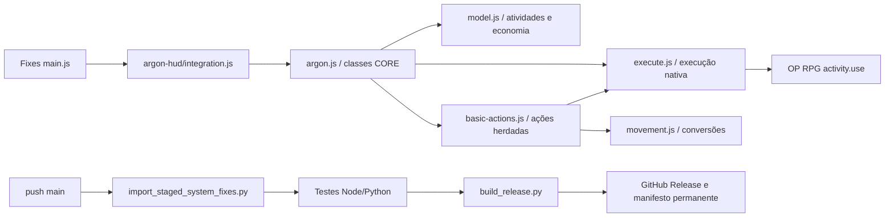

# Codebase Map

Mapeado com Cartographer em 2026-11-12T05:39:52Z, por três agentes de leitura. Escopo: integração Argon e publicação. Scanner de tokens indisponível por ausência de tiktoken; nenhum total estimado é apresentado.

## Integração ativa

| Arquivo sob modules/oprpg-system-fixes | Responsabilidade |
|---|---|
| main.js | Instala hook Argon na avaliação do módulo; settings no init |
| scripts/argon-hud/integration.js | Gate sistema/CORE/setting/legado, diagnóstico, atualização por documentos |
| scripts/argon-hud/model.js | Coleções, IDs de atividades, agrupamento, economia, custos informativos, escape |
| scripts/argon-hud/execute.js | Resolve documento atual, propriedade, bloqueio nativo, trava concorrente e cancelamento |
| scripts/argon-hud/argon.js | Retrato, economia, categorias, listas, drawer, teclado, movimento e macros |
| scripts/argon-hud/basic-actions.js | Ações recuperadas 6.4.1; efeitos próprios, Preparar, expiração e hooks Esquivar |
| scripts/argon-hud/movement.js | Movimento real, unidades e histórico V14 |
| scripts/api.js | API pública game.oprpgFixes.argon; API game.oprpg de Haki/PP |
| scripts/module-compatibility.js | Diagnóstico de adaptadores duplicados |
| styles/argon-oprpg.css | Estilos compactos restritos à integração interna |

Não gastar PP, aplicar dano ou repetir efeitos de atividade na camada visual. O ponto único de execução é executeEntry; Preparar também o utiliza. Alterar hierarquia em model.js/argon.js e conferir tipos de item/ativação reais. Atividade removida não cai na primeira atividade disponível.

## Referência histórica

`modules/enhancedcombathud-oprpg-system` 6.4.1 fica preservado e desativado quando se usa a integração interna. Seus arquivos integration.js, utils.js, activity-ui.js, oprpg-api.js e basic-actions.js documentam as APIs anteriores. O layout antigo usava cartões grandes; não é o modelo visual atual. Não havia contador universal real de ações a migrar.

## Publicação e testes

`tests/argon-integrated.mjs` testa modelo, executor, registro de classes, retrato, movimento e ações básicas com documentos falsos. `tests/test_staged_import.py` impede regressão de sobrescrita pelo ZIP publicado. `tests/argon-browser-server.cjs` e `argon-browser.html` fornecem renderização simulada com checkout externo do CORE e Handlebars externos, sem redistribuir o sistema oficial.

`.github/workflows/release.yml` importa somente pacote mais novo, executa testes, rejeita tag existente, valida/compacta e publica. `scripts/build_release.py` confere sintaxe e integridade e mantém URL latest/download estável. O workflow também embala os demais módulos, preservando suas versões e fontes.

## Limites

CORE é opcional; adaptador antigo ativo bloqueia o interno. Haki é aberto pela API nativa; PP vêm de energy. Fonte oficial do OP RPG fica somente na pasta local ignorada, inclusive arquivos com licenças individuais, e jamais deve entrar em commit ou ZIP. Não há mundo Foundry neste workspace; verificação de navegador é simulada. Consulte REVISAO-1.27.14.md para evidência e rollback.
